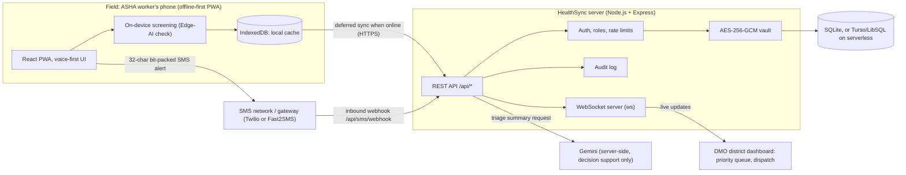

# HealthSync Edge: Architecture

This document explains how the pieces fit together. It follows the project deck (Technical Approach) and the server code in `server.ts` and `src/server/`.

## 1. Design goals

- **Works with zero connectivity.** The field app must be usable offline and sync later.
- **Small alerts.** A serious case must be able to reach the district office as a very short SMS.
- **Safe by default.** Patient data is encrypted at rest, access is role-based, and every important action is logged.
- **Standards-friendly.** Records are FHIR-aligned and carry an ABHA ID field so they can fit into ABDM later.

## 2. System diagram

## 3. Data flow for one emergency case

1. The ASHA worker records a visit in the PWA. The record is validated and stored in IndexedDB on the phone.
2. The on-device screening flags the case as serious.
3. A short bit-packed alert (32 characters, with an integrity check) is sent by SMS so the district office is told immediately.
4. When the phone has data again, the full FHIR-aligned record is sent to `POST /api/records`.
5. The server checks the user's role and ownership, validates the village code and patient name, checks guardian consent for minors, saves the record, and writes an audit log entry.
6. The server pushes a `record:created` event over WebSocket to every connected DMO and to the ASHA worker who owns the record. Nobody else receives it.
7. The DMO sees the case in the live priority queue and calls `PATCH /api/records/:id/dispatch` to assign an ambulance. A `record:updated` event goes back out.

## 4. Components

### 4.1 Field app (React PWA)

- React 19 + Vite, installable as a PWA (`vite-plugin-pwa`).
- Voice-first workflow (Hindi and English, Marathi planned).
- IndexedDB holds records while offline. Records are validated before sending and de-duplicated on sync.

### 4.2 Server (`server.ts`)

- Express app with Helmet: Content-Security-Policy, HSTS, frame protection, `nosniff`, referrer policy, and a Permissions-Policy that limits camera and microphone to same-origin.
- JSON body limit of 256 KB.
- Public liveness check at `GET /api/health`. Device counts and gateway status are shown only to a logged-in DMO.

### 4.3 Authentication and roles

| Role | What they can do |
|---|---|
| **ASHA** | Create and update their own triage records, submit field-visit stipend entries. Must be **verified** first. |
| **DMO** | See all records, approve or revoke ASHA accounts, dispatch ambulances, erase patient data, create other DMO accounts. |

- Bearer session tokens, with rotation (`/api/auth/rotate-session`), logout, and logout-from-all-devices.
- An ASHA account is verified in one of two ways: a valid clinic enrollment code at registration, or approval by a DMO. Until then it cannot read or write patient records.
- A DMO account can only be created by an existing DMO or with the DMO provisioning code.
- Login failures return one generic message so attackers cannot tell whether an account exists.

### 4.4 Record authorization

- Object-level checks: an ASHA worker can only change records they own.
- Only a DMO can set a record to `Dispatched`, or set the ambulance unit and ETA (ETA is limited to 1 to 180 minutes).
- Village code and patient name are validated on every write.
- Parent or guardian consent is validated for patients under 18 (DPDP Act, Section 9).

### 4.5 Storage and encryption

- SQLite through `better-sqlite3`. On serverless platforms (for example Vercel) a remote Turso/LibSQL database keeps records across cold starts.
- Patient data is encrypted at rest with AES-256-GCM. The key comes from `VAULT_ENCRYPTION_KEY`, and a fingerprint is checked at startup so the key cannot be silently replaced.
- Rate-limit counters are stored in the database, so limits survive restarts.

### 4.6 Rate limits

| Limit | Value |
|---|---|
| Failed logins per IP | 15 per 15 minutes |
| Registration attempts per IP | 15 per 15 minutes |
| Gemini summaries | 10 per user and 15 per IP, per 15 minutes |
| Emergency SMS | 5 per user and 8 per IP per 15 minutes, 15 per user per day |
| Total SMS per day (whole deployment) | `SMS_DAILY_GLOBAL_LIMIT` (default 200) |

### 4.7 Audit log

Important actions are written to an audit log: registration, login success and failure, session rotation, logout, ASHA approval or revocation, record saved, ambulance dispatched, and data erasure.

### 4.8 AI

- **On-device screening** (anemia, cough) runs in the browser, so no cloud trip is needed.
- **Gemini summary** runs on the server through `@google/genai`. If Gemini is unavailable, a built-in fallback summary is used.
- Both are labelled as decision support. They are not a diagnosis.

### 4.9 SMS

- Outbound alerts go through Twilio or Fast2SMS when configured. A recipient allowlist and daily limit prevent abuse.
- Inbound messages arrive at `/api/sms/webhook` and are authenticated with a Twilio signature or a shared secret.

### 4.10 Real-time updates

- A WebSocket server (`ws`) pushes record events.
- Each message is scoped. DMOs receive everything. An ASHA worker receives only events for records they own, and only if verified.

## 5. Standards

- Records are FHIR-aligned JSON. See [../sample-data/fhir-encounter-bundle.json](../sample-data/fhir-encounter-bundle.json).
- An ABHA ID field is captured. Full ABDM API integration is planned.

## 6. Deployment

- Local: `npm run dev` runs the Express server, which also serves the frontend.
- Hosted: Vercel (`vercel.json`) with a Turso database for durable storage.

## 7. Known limits and next steps

- On-device screening needs clinical validation before field use.
- Field pilot with ASHA workers and district officers is planned.
- ABDM/ABHA API integration and Marathi voice support are planned.
